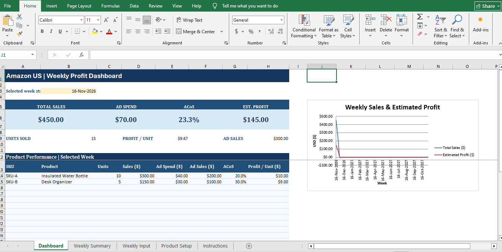
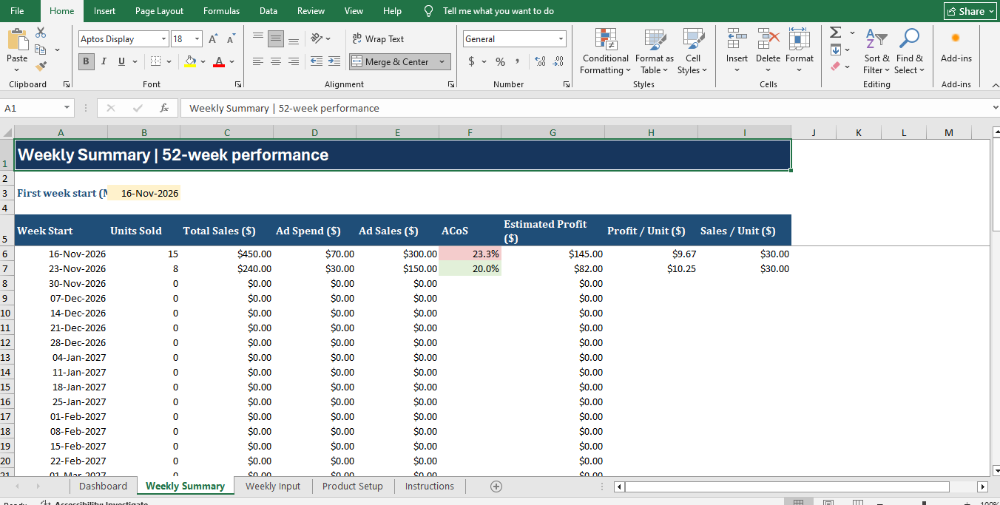
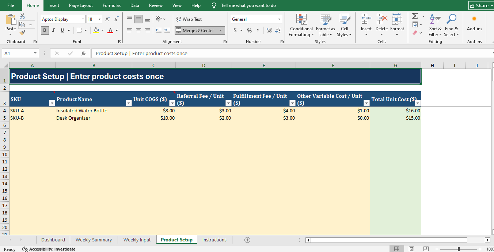

# Amazon US Weekly Profit Report (Excel)

## Project Overview
An Excel reporting template designed to help an Amazon US seller review weekly sales, advertising performance, ACoS, and estimated profit by SKU.

This is a self-initiated portfolio demonstration built with illustrative dummy data. It is not an official Amazon report and does not imply access to a real Amazon Seller Central account.

## Dashboard Preview

## Workbook Screenshots

### Weekly Summary

### Product Setup

## Business Objective
- Monitor total sales and advertising spend.
- Track advertising cost of sales (ACoS).
- Estimate profit and profit per unit using entered product costs and fees.
- Compare weekly performance over a 52-week period.
- Review performance by SKU.

## Workbook Structure

| Worksheet | Purpose |
|---|---|
| Dashboard | Selected-week KPI summary and product-level performance |
| Weekly Summary | 52-week performance trends |
| Weekly Input | Weekly data entry, one row per SKU per week |
| Product Setup | Product names and per-unit cost assumptions |
| Instructions | Usage guidance and calculation definitions |

## Key Metrics
- **ACoS** = Ad Spend / Ad-attributed Sales
- **Estimated Profit** = Total Sales - Ad Spend - Product COGS - Referral Fees - Fulfillment Fees - Other Variable Costs
- **Profit per Unit** = Estimated Profit / Units Sold
- **Sales per Unit** = Total Sales / Units Sold

Ad-attributed sales are a subset of total sales and are not added to total sales again.

## Sample Data Used for Testing
The demonstration workbook contains illustrative sample data for two products:

| Product | Units Sold | Total Sales | Ad Spend | Ad Sales |
|---|---:|---:|---:|---:|
| Insulated Water Bottle | 10 | $300.00 | $40.00 | $200.00 |
| Desk Organizer | 5 | $150.00 | $30.00 | $100.00 |
| **Total** | **15** | **$450.00** | **$70.00** | **$300.00** |

Sample week results:
- ACoS: **23.33%**
- Estimated profit: **$145.00**

These are sample test values only, not actual business results.

## Validation
Tested with sample data for:
- ACoS calculations at SKU and weekly levels.
- Estimated profit and profit-per-unit calculations.
- Weekly aggregation.
- Dashboard KPI values and product-level results.
- Formula error scan (no formula error values detected in the tested workbook).

## Tools and Skills
- Microsoft Excel
- Excel formulas (SUM, SUMIFS, IF, IFERROR, INDEX, MATCH)
- Data organization and validation
- KPI reporting and dashboard design
- Weekly performance tracking
- Basic profitability and advertising analysis

## Assumptions and Limitations
- Profit is an estimate based on costs entered in `Product Setup`.
- The model includes unit COGS, referral fee, fulfillment fee, other variable cost, and ad spend.
- It does not automatically import data from Amazon Seller Central.
- Refunds, storage fees, promotions, taxes, and other adjustments are not included unless incorporated into the cost assumptions.
- Input ranges can be extended for larger datasets.

## Project Files
- `Amazon_US_Weekly_Profit_Report_Template.xlsx` — clean workbook ready for new data.
- `Amazon_US_Weekly_Profit_Report_Demo_with_Dummy_Data.xlsx` — tested demo workbook with illustrative data.
- `DATA_DICTIONARY.md` — explanation of weekly input fields.

---
Created as a portfolio demonstration by **Abdur Rahim**.
